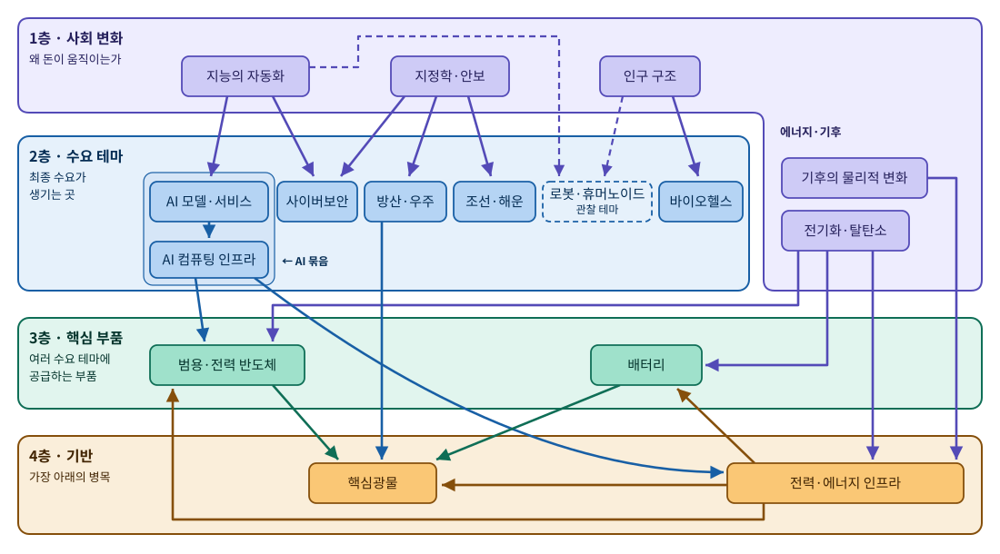

# 글로벌 산업 테마 노트

> 기준일: 2026-10-17 · 영향이 크고, 변화가 많고, 국경을 넘어 서로 영향을 주고받는 산업을 일반인이 읽을 수 있는 수준으로 정리한 문서 묶음입니다. 투자 권유가 아닙니다.

## 이 문서 묶음의 틀

산업을 따로따로 보면 "무엇이 늘고 있는가"는 보이지만 "왜 늘고 있고, 언제 꺾일 수 있는가"는 놓치기 쉽습니다. 그래서 이 노트는 **사회 변화(왜)에서 출발해 수요 테마(어디서 돈이 쓰이나), 핵심 부품(무엇이 공통으로 필요한가), 기반(가장 아래의 병목)으로 내려가는** 구조로 짰습니다. 여러 테마에 걸치는 사안은 교차 이슈 노트로 따로 관리합니다.



| 색 | 층 | 설명 |
|:-:|---|---|
| 🟪 | **1층 · 사회 변화** | 모든 투자의 근본 이유. 느리게 움직이며 분기·반기마다 "흐름이 약해지는 신호"를 점검 |
| 🟦 | **2층 · 수요 테마** | 정부·기업·소비자가 직접 돈을 쓰는 산업. 점선 테두리는 관찰 테마 |
| 🟩 | **3층 · 핵심 부품** | 두 개 이상의 수요 테마에 공급하는 부품 산업 |
| 🟧 | **4층 · 기반** | 거의 모든 테마가 기대는 가장 아래의 병목(전력, 원자재) |

**화살표 읽는 법:** 화살표는 "수요가 흘러가는 방향"이고, 색은 **출발한 층의 색**을 따릅니다. 실선은 주요 연결, 점선은 관찰 테마와의 연결입니다. 기반층이 부품을 사는 경우(전력 인프라의 ESS용 배터리, 인버터·송전 변환장치용 전력반도체)에는 화살표가 아래층에서 위층으로 향합니다.

그림에는 문서에 적힌 연결을 모두 그리지 않고, 아래 기준에 맞는 것만 그립니다. 전체 연결은 각 문서의 머리 표에 있습니다.

- **사회 변화 → 테마:** 사회 변화가 그 테마의 수요를 직접 만들고, 그림 안에 다른 경로로 이미 보이지 않을 때만 그립니다. 공급망 규칙을 바꾸는 "조건"으로 작용하는 연결(예: 지정학 → 배터리·광물·AI)이나, 다른 테마를 거쳐 이미 보이는 연결(예: 지능의 자동화 → AI 모델·서비스 → AI 컴퓨팅 인프라 → 전력)은 생략합니다.
- **테마 → 테마:** 받는 쪽 테마의 세부 산업 가운데 하나 이상에서 주요 수요처일 때만 그립니다. 예를 들어 방산의 드론과 로봇은 배터리 전체 수요에서 비중이 작아 화살표를 그리지 않았습니다. 반면 방산 → 핵심광물은 안티모니·텅스텐 같은 소수금속에서 방산이 주요 수요처라서 그렸습니다.

2층 왼쪽의 테두리는 "AI 묶음"으로, 최종 수요(AI 모델·서비스)와 그 전용 공급망(AI 컴퓨팅 인프라)을 함께 묶은 것입니다. 1층은 ㄱ 자 모양으로, 왼쪽 위는 "왜 돈이 움직이는가", 오른쪽 아래로 내려온 부분은 "에너지·기후"입니다. 그림을 고칠 때는 `assets/make_layer_map.py`의 좌표를 수정한 뒤 실행하면 `assets/layer-map.svg`가 다시 만들어집니다. 사회 변화와 테마의 전체 연결은 아래 [연결 표](#사회-변화와-산업-테마의-연결)에서 확인할 수 있습니다.

## 읽는 순서

1. [사회 변화](megatrends/) 문서 5개로 큰 그림을 잡습니다.
2. 관심 있는 [산업 테마](themes/) 문서를 읽습니다. 각 문서 맨 위 표에서 층·단계, 상위 동인, 연결 테마, 교차 이슈로 이동할 수 있습니다.
3. 여러 테마에 걸친 사안은 [교차 이슈](issues/)에서, 아직 규모가 작은 산업은 [관찰 테마](watch/)에서 봅니다.
4. 모르는 용어는 링크를 눌러 [용어집](glossary.md)에서 확인합니다.
5. 이 노트를 투자 판단에 어떻게 연결할지는 [테마 관찰과 투자 전략](investing-framework.md)에서 봅니다. 특정 종목을 권하지 않는 방법론 문서입니다.

## 분류 규칙

### 층을 나누는 규칙

| 층 | 정의 | 판정 기준 |
|---|---|---|
| 수요 | 최종 수요가 생기는 산업 | 돈을 쓰는 주체(정부, 기업, 소비자)가 직접 사는 제품·서비스 |
| 핵심 부품 | 여러 수요 테마에 공급하는 부품 산업 | 아래 세 조건을 모두 충족 |
| 기반 | 거의 모든 테마가 기대는 가장 아래의 병목 | 전력과 원자재처럼 대체가 불가능하고 여러 층에 걸침 |

**핵심 부품층으로 분리하는 조건**
1. 두 개 이상의 수요 테마에서 의미 있는 비중을 차지한다.
2. 한 테마로의 쏠림이 약하다(대략 최대 수요처가 60~70% 미만).
3. 고유한 공급망과 병목을 가진다.

여러 테마에 쓰여도 한쪽으로 크게 쏠려 있으면 그 테마 안에 둡니다. 예를 들어 GPU·HBM은 로봇에도 쓰이지만 AI 데이터센터에 압도적으로 몰려 있어 AI 묶음에 두고, 감속기·액추에이터는 로봇에 몰려 있어 로봇 테마에 둡니다.

**전용 공급망 묶음:** 한 수요 테마에만 공급하는 공급망이라도, 그 자체로 규모가 크고 고유한 병목을 가지면 같은 테마 묶음 안에서 문서를 나눕니다. AI 묶음이 그 예입니다. 최종 수요는 [AI 모델·서비스](themes/demand/ai-services.md)가, 그 전용 공급망은 [AI 컴퓨팅 인프라](themes/demand/ai-compute.md)가 맡습니다. 두 문서는 짝으로 읽어야 합니다. 인프라 투자가 지속될 수 있는지는 서비스 매출에 달려 있기 때문입니다.

### 테마의 단계

발표나 화제성이 아니라 **돈과 공급망이 실제로 움직이는지**로 판정합니다.

| 단계 | 진입 조건 | 관리 방식 |
|---|---|---|
| 레이더 | 기술적 가능성 논쟁 중, 상업 매출이 거의 없음, 계획·발표 위주 | 이 README의 레이더 목록에 한 줄. 반기마다 승격 조건만 확인 |
| 관찰 | 아래 3개 중 2개 이상 충족: ① 유료 고객 또는 확정 주문 ② 정부·대기업의 예산 **집행**(발표가 아님) ③ 전용 부품·소재 공급사의 등장 | `watch/` 폴더의 가벼운 문서: 핵심 지표, 승격·강등 조건. 분기 점검 |
| 본 테마 | 아래 선정 기준 3개 충족, 매출·출하량·설비투자 지표가 정기적으로 나옴, 병목이 실제로 가격·납기를 움직임 | `themes/` 폴더의 상세 문서. 월간 점검 |

### 테마 선정 기준

1. **영향이 크다:** 세계 설비투자나 정부 예산이 대규모로 몰리고, 여러 나라 경제에 파급된다.
2. **변화가 많다:** 기술 세대, 경쟁 구도, 규제가 1~2년 단위로 바뀐다.
3. **글로벌하게 주고받는다:** 한 나라의 정책이나 한 기업의 결정이 다른 나라 산업에 바로 전파된다.

## 사회 변화

| 문서 | 핵심 질문 | 점검 주기 |
|---|---|---|
| [1. 지능의 자동화](megatrends/01-automation-of-intelligence.md) | AI 투자는 매출로 회수되며 계속될 수 있는가 | 분기 |
| [2. 전기화와 탈탄소](megatrends/02-electrification.md) | 정책 후퇴 속에서도 비용·안보 논리로 전환이 이어지는가 | 분기 |
| [3. 지정학 블록화와 안보 불안](megatrends/03-geopolitics-security.md) | 블록화와 재무장의 강도가 커지는가, 완화되는가 | 분기 + 협상 시한 전후 |
| [4. 인구 구조 변화](megatrends/04-demographic-change.md) | 늙는 선진국과 커지는 신흥국의 수요가 어떤 산업으로 이어지는가 | 반기 |
| [5. 기후의 물리적 변화](megatrends/05-climate-physical.md) | 이미 일어난 기후 변화에 적응하는 비용이 어디로 흐르는가 | 반기 |

### 거시 조건

금리·재정, 경기 사이클, 환율은 사회 변화가 아니라 **조건**으로 다룹니다. 방향을 만들지는 않지만 속도를 좌우합니다. 특히 원전, 재생에너지, 송전망, 데이터센터처럼 초기 투자가 큰 산업은 금리에 민감합니다. 이 조건들은 별도 문서 없이, 각 테마의 위험 요소와 이 README의 일정표에서 다룹니다.

## 산업 테마

| 층 | 문서 | 세부 산업 | 지금의 대표 병목 |
|---|---|---|---|
| 수요(AI 묶음) | [AI 모델·서비스](themes/demand/ai-services.md) | 파운데이션 모델, AI 플랫폼·유통, 애플리케이션·에이전트, 기존 소프트웨어 잠식 | 연산 자원, 투자 대비 매출, 가격 하락 |
| 수요(AI 묶음) | [AI 컴퓨팅 인프라](themes/demand/ai-compute.md) | 가속기 설계, 파운드리·패키징, HBM, 장비·소재, 데이터센터 | CoWoS 패키징, HBM, 전력·용수 |
| 수요 | [사이버보안](themes/demand/cybersecurity.md) | 엔드포인트·클라우드, 네트워크, 신원, 보안 운영, OT, 양자내성암호 | 숙련 인력, 위협 데이터, 인증 |
| 수요 | [방산·우주](themes/demand/defense-space.md) | 탄약, 미사일·방공, 무인기, 우주, 사이버·전자전 영역 | 고체로켓모터, 발사 슬롯 |
| 수요 | [조선·해운](themes/demand/shipbuilding.md) | 상선 건조, 기자재, 해군 함정·MRO, 해운 | 숙련 인력, 미국 법적 제약 |
| 수요 | [바이오헬스](themes/demand/biohealth.md) | 비만치료제, CDMO, 공정 소재 | 충전·주사기, 규제 승인 |
| 수요(관찰) | [로봇·휴머노이드](watch/robotics-humanoid.md) | 완성 로봇, 액추에이터·감속기, 센서 | 관절 부품, 희토류 자석 |
| 핵심 부품 | [배터리](themes/components/battery.md) | 소재, 셀 / 수요처: ESS, 전기차, 드론·로봇 | 중국 소재 의존, 미국 수요 부진 |
| 핵심 부품 | [범용·전력 반도체](themes/components/general-power-semis.md) | 전력반도체(SiC·GaN·IGBT), MCU·아날로그 | 공급망 무기화, 중국 가격 공세 |
| 기반 | [전력·에너지 인프라](themes/foundation/power-energy.md) | 가스터빈, 원자력·SMR, 송배전 기기, 재생에너지·ESS | 터빈·변압기 납기, HALEU |
| 기반 | [핵심광물](themes/foundation/critical-minerals.md) | 희토류·자석, 리튬, 니켈·코발트, 구리, 소수금속 | 중국 정제 집중, 수출통제 |

### 레이더 목록

| 대상 | 지금 위치 | 관찰로 올릴 신호 |
|---|---|---|
| 우주 데이터센터 | 시제품 시험 단계. 상세는 [교차 이슈](issues/space-datacenter.md) | 궤도 시험 성공, 대형 재사용 로켓 상용화, 첫 유료 고객 |
| 양자컴퓨팅 | 상용 기기·상장사는 있으나 기존 컴퓨터보다 나은 실용 사례 없음 | 오류를 바로잡은 논리 큐비트의 실용 규모 시연, 상업적 우위 사례. 단, 양자 위협에 대비한 **암호 전환은 이미 진행 중**이라 [사이버보안](themes/demand/cybersecurity.md)에서 다룸 |

## 교차 이슈

| 노트 | 걸치는 테마 | 상태 |
|---|---|---|
| [미·중 휴전 유예 만료(2027-01)](issues/us-china-truce-2027-01.md) | 광물, 배터리, 방산, AI, 조선, 범용 반도체 | 임박 |
| [우주 데이터센터와 위성 인프라](issues/space-datacenter.md) | AI, 방산·우주, 전력 | 레이더 |
| [초합금·정밀 주단조](issues/superalloy-castings.md) | 전력(가스터빈), 방산·우주(엔진) | 진행 중인 병목 |
| [사이버·전자전](issues/cyber-electronic-warfare.md) | 방산, 사이버보안, 전력 | 진행 중 |

**교차 이슈 노트를 만드는 조건:** 두 개 이상의 테마에 걸치고, 구체적인 시점이나 계기가 있을 때. 본문은 이슈 노트 한 곳에만 쓰고, 관련 테마 문서에는 한 줄 요약과 링크만 둡니다.

## 사회 변화와 산업 테마의 연결

● 강한 연결 · ○ 보통 연결 · 빈칸은 약하거나 없음

| | AI 서비스 | AI 인프라 | 사이버 | 방산·우주 | 조선 | 바이오 | 로봇(관찰) | 배터리 | 범용·전력 반도체 | 전력 | 광물 |
|---|:-:|:-:|:-:|:-:|:-:|:-:|:-:|:-:|:-:|:-:|:-:|
| 지능의 자동화 | ● | ● | ● | ○ | | ○ | ● | | ○ | ● | ○ |
| 전기화·탈탄소 | | | | | ○ | | | ● | ● | ● | ● |
| 지정학·안보 | ● | ● | ● | ● | ● | ○ | ○ | ● | ● | ○ | ● |
| 인구 구조 | ○ | | | | ○ | ● | ● | | | ○ | |
| 기후의 물리적 변화 | | ○ | | | | | | ○ | ○ | ● | |

지정학은 거의 모든 테마에 걸쳐 있습니다. 수요를 직접 만들기도 하지만(방산, 조선), 다른 테마의 공급망 규칙을 바꾸는 "조건"으로 작동하는 경우가 더 많습니다. 여러 사회 변화에 강하게 연결된 테마일수록 수요가 단단하다고 볼 수 있습니다.

## 테마 사이의 선후관계

| 사슬 | 흐름 | 의미 |
|---|---|---|
| AI 서비스 → AI 인프라 → 전력 → 광물 | AI 서비스 수요 → 데이터센터 증가 → 전력 수요 급증 → 가스터빈·변압기 부족 → 구리·전기강판 수요 | 가장 강한 연쇄. 출발점의 매출이 꺾이면 사슬 전체가 흔들리고, 끝점의 전력 병목은 거꾸로 AI 투자 속도를 묶음 |
| 지정학 → 방산·조선 → 광물·주조 | 재무장 → 미사일·함정·드론 수요 → 희토류 자석·소수금속·초합금 주조 수요, 동시에 중국의 광물 통제 | 수요 증가와 공급 제한이 같은 원인에서 나옴 |
| 전기화 → 배터리·범용 반도체 → 광물 | 전기차·ESS·전력망 확대 → 배터리 소재, 전력반도체 수요 → 리튬·흑연·갈륨 | 광물 가격과 통제가 부품 원가를 결정 |
| 되먹임 1 | 전력·용수 부족, 지역 반발 → AI 데이터센터 착공 지연 | 하류가 상류의 속도를 제한 |
| 되먹임 2 | ESS 확대 → 전력망 안정화 → 재생에너지·데이터센터 연결 확대 | 부품이 기반 병목을 일부 해소 |

바이오헬스는 이 연결망에서 상대적으로 독립적입니다. 지정학(생물보안법, 의약품 관세)과 AI 신약개발 정도로만 연결됩니다.

## 다가오는 주요 일정

| 날짜 | 사건 | 영향 테마 |
|---|---|---|
| 2026-11-09 | 미국 항만 수수료·50% 규칙 유예의 연방관보 기한. 10-23 현재 연장 고시 없음 | 조선, AI, 범용 반도체 |
| 2027-01-10 | 미·중 유예 조치 만료(중국 상무부 발표 기준): 중국 희토류·배터리 소재 통제, 미·중 항만 수수료, 한화오션 미국 자회사 제재, 미국 50% 규칙 | 광물, 배터리, 방산, AI, 조선, 범용 반도체 |
| 2026년 말 | 노보노디스크 카그리세마 미국 허가 결정 예상 | 바이오헬스 |
| 2026년 말 | 스페이스X 스타십 첫 궤도 임무 목표 | 방산·우주, 우주 데이터센터 |
| 2026-12-02 | 유럽연합 AI법: 기존 AI 생성물 워터마킹 의무, 불법 합성 이미지 생성 AI 금지 시행 예정(2026년 5월 잠정 합의 기준) | AI 모델·서비스 |
| 2027-01-01 | 미국 NSA CNSA 2.0, 국가안보 시스템 신규 도입에 양자내성암호 요구 시작 | 사이버보안, 방산 |
| 2027년 | CoWoS 패키징 부족 완화 예상, 구글 선캐처 위성 2기 추가 발사 계획 | AI 컴퓨팅, 우주 데이터센터 |
| 2027년 하반기 | GE 에어로스페이스의 CPP 인수 종결 예정 | 전력, 방산·우주(정밀 주조) |

## 다음에 검토할 후보

| 후보 | 형태 | 이유 |
|---|---|---|
| 물 인프라(수처리, 재이용수, 담수화) | 수요 테마 후보 | 기후 변화와 반도체·데이터센터 용수 문제가 만나는 지점 |
| 특수소재·정밀가공 | 핵심 부품층 후보 | 초합금 주조 병목이 반복되면 교차 이슈에서 승격 |
| 엣지 AI 칩 | AI 컴퓨팅에서 분리 후보 | 휴머노이드·자동차 물량이 커지면 검토 |
| 광통신 | AI 컴퓨팅에서 분리 후보 | 데이터센터 내부 연결이 독립 병목으로 커지면 검토 |
| 의료기기·디지털 헬스 | 수요 테마 후보 | 고령화의 또 다른 축 |
| 식량·비료 | 수요 테마 후보 | 기후·지정학이 만나는 지점 |
| 디지털 금융·결제(스테이블코인 포함) | 수요 테마 후보(범위 결정 필요) | 달러 스테이블코인과 디지털 위안의 경쟁처럼 지정학과 만나는 지점. 다만 이 프로젝트가 금융 산업을 범위에 넣을지부터 정해야 하고, 넣는다면 사이버보안처럼 "다른 틀로 읽어야 하는" 테마가 됨 |

### 독립 테마로 두지 않은 대상

**암호화폐·토큰 경제** (2026-10-20 검토)

독립 테마로 두지 않습니다. 이 분야는 "변화가 많다"와 "글로벌하게 주고받는다"는 충족하지만, "영향이 크다"에서 말하는 설비투자나 정부 예산의 이동은 좁습니다. 시장 규모의 대부분은 자산 가격이고, 다른 테마로 이어지는 돈의 흐름은 일부에 그칩니다. 디파이, NFT, 유틸리티 토큰 같은 토큰 경제는 연결 표에 그을 화살표가 거의 없습니다. 이 프로젝트의 뼈대는 층과 층을 잇는 공급망인데, 그 연결망 밖에 있다는 뜻입니다. 또 토큰을 다루면 결국 가격 전망 이야기가 되기 쉬워, 일반인 독자를 위한 "투자 권유가 아닌 산업 정리"라는 원칙을 지키기 어렵습니다. "탈중앙화·디지털 화폐"를 사회 변화로 올리기에도 "되돌리기 어려움"과 "여러 산업을 동시에 움직임"을 아직 보여 주지 못합니다.

대신 기존 테마와 실제로 맞닿는 부분은 해당 문서에서 다룹니다. 아래 접점은 아직 문서에 반영하지 않았고, 다음 정기 갱신 때 자료를 확인해 넣습니다.

| 접점 | 다룰 문서 | 이유 |
|---|---|---|
| 비트코인 채굴장의 AI 데이터센터 전환 | [AI 컴퓨팅 인프라](themes/demand/ai-compute.md), [전력·에너지 인프라](themes/foundation/power-energy.md) | 채굴 업체가 확보해 둔 전력망 접속권과 부지를 AI 연산 임대로 돌리는 사례. "전력 접속이 병목"이라는 기존 논지와 직결되는 가장 강한 연결 |
| 국가 배후 조직의 거래소 해킹 | [사이버보안](themes/demand/cybersecurity.md), [사이버·전자전](issues/cyber-electronic-warfare.md) | 북한 등의 해킹 수익이 무기 개발 자금원으로 이어짐 |
| 블록체인 서명 방식의 양자내성암호 전환 | [사이버보안](themes/demand/cybersecurity.md)의 양자내성암호 부분 | 암호 전환이 금융 인프라에서 얼마나 진행되는지 보여 주는 관전 포인트 |
| 달러 스테이블코인과 디지털 위안 | [지정학 블록화와 안보 불안](megatrends/03-geopolitics-security.md) | 스테이블코인 발행사의 미국 단기국채 매입, 달러 결제망과 중국 결제망의 경쟁. 범위가 커지면 위 "디지털 금융·결제" 후보로 검토 |

다시 검토할 신호는 두 가지입니다. 채굴 외의 블록체인 사업이 다른 테마의 설비투자나 공급망을 실제로 움직이는 경우, 그리고 스테이블코인이 국가 간 결제나 국채 시장에서 정책 변수가 될 만큼 커지는 경우입니다.

## 폴더 구조

```
industry-themes/
├── README.md              # 이 문서: 틀, 분류 규칙, 연결, 일정
├── CLAUDE.md              # Claude Code 작업 안내(작성 규칙, 갱신 절차, 다음 할 일)
├── glossary.md            # 용어집
├── investing-framework.md # 테마 관찰과 투자 전략 (방법론, 자동 갱신 대상 아님)
├── megatrends/            # 1층: 사회 변화 (분기·반기 점검)
├── themes/
│   ├── demand/            # 2층: 수요 테마 (월간 점검)
│   ├── components/        # 3층: 핵심 부품 (월간 점검)
│   └── foundation/        # 4층: 기반 (월간 점검)
├── watch/                 # 관찰 테마 (분기 점검)
├── issues/                # 교차 이슈 (사안별 주기)
├── log/                   # 월별 기록: 문서 변화 요약과 판단
├── assets/                # 구조도 SVG와 생성 스크립트
├── tools/                 # 점검 스크립트 (링크 검사)
├── .claude/               # Claude Code 프로젝트 설정 (클라우드 세션 훅)
└── .github/workflows/     # GitHub Actions (링크 검사, @claude 호출)
```

## 작성 원칙

자동 업데이트를 붙일 때도 아래 원칙을 그대로 지킵니다.

- **기준일을 적는다:** 모든 문서 상단에 기준일을 두고, 수치에는 시점을 함께 적는다.
- **1차 자료만 출처로 쓴다:** 정부·국제기구의 공식 문서, 기업의 공식 발표·공시, 데이터를 직접 만든 기관의 발표만 출처로 쓰고, 문서 하단 출처 목록에 URL을 남긴다. 언론 기사는 출처로 쓰지 않으며, 1차 자료로 확인되지 않는 사실은 넣지 않는다. 기관의 추정치는 "추정"이라고 밝힌다.
- **일반인이 읽을 수 있게 쓴다:** 줄글 위주로 쓰고, 비교가 필요한 곳에만 표를 쓴다. 전문 용어는 처음 나올 때 용어집으로 링크한다.
- **같은 틀을 유지한다:** 세부 산업마다 밸류체인 → 산업 구조 → 키 플레이어 → 병목 구간 → 위험 요소 순서로 쓴다. 소프트웨어 산업(사이버보안)처럼 틀이 맞지 않으면 문서 첫머리에 바꾼 틀을 밝힌다.
- **머리 표를 유지한다:** 모든 테마 문서 맨 위에 층·단계, 상위 동인, 기대는 테마, 영향을 주는(또는 공급하는) 테마, 교차 이슈를 적는다.
- **연결을 한 곳에 쓴다:** 여러 테마에 걸친 사안은 교차 이슈 노트에 본문을 쓰고, 각 테마에는 링크만 둔다. 연결이 바뀌면 양쪽 머리 표와 이 README의 표를 함께 고친다.
- **단계를 점검한다:** 관찰·레이더 대상은 정해진 주기에 승격·강등 조건을 확인하고, 바뀌면 이 README의 표를 고친다.
- **관찰과 투자 판단을 섞지 않는다:** 테마 문서에는 종목 의견, 목표 가격, 투자 비중을 쓰지 않는다. 투자와의 연결은 [테마 관찰과 투자 전략](investing-framework.md)에서 방법론 수준으로만 다루고, 이 문서는 자동 갱신하지 않는다.
